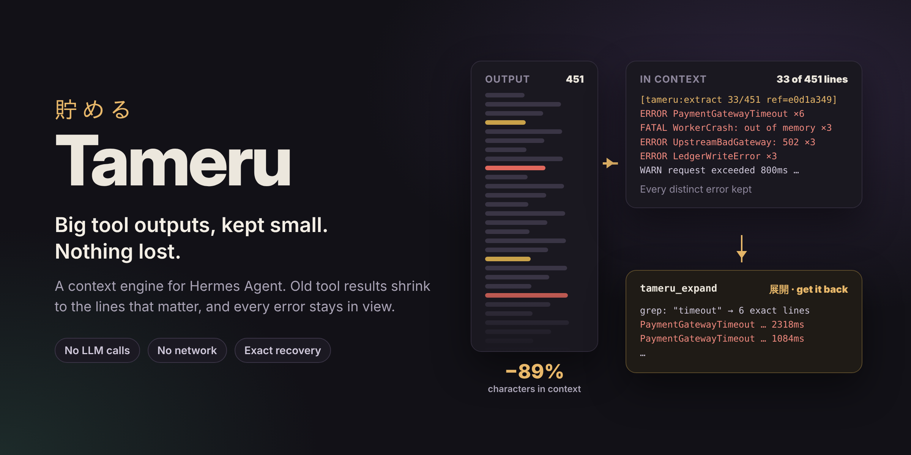

# hermes-tameru-plugin



[Tameru](https://github.com/0xWhiteMage/tameru-compaction-system) deterministic, extractive context compaction for
[Hermes Agent](https://github.com/NousResearch/hermes-agent), as a standalone context-engine plugin (no Hermes source
changes). **Version 1.5.0**, vendoring Tameru 1.5.0.

When Hermes trims an old tool result, it normally replaces it with a one-line summary. This plugin keeps the part
that matters instead: a query-aware extract or a structural brief that always holds one line of every distinct
error, and a `ref=` from which the exact original can be fetched back with the `tameru_expand` tool. Hermes still
decides when to prune, which rows, and whether a pass is worth committing.

Measurements: [docs/REPORT-1.5.0.md](docs/REPORT-1.5.0.md). Changes by version: [CHANGELOG.md](CHANGELOG.md).
Releasing: [docs/RELEASING.md](docs/RELEASING.md).

## At a glance

Replay of five session shapes (debugging, on-call incident, refactor, many small outputs, non-English output) at six
window sizes (32K to 256K), two seeds each, against Hermes with its default settings (proactive prune off). The
replay runs on a simulated clock and rejects any request larger than the window, as a provider does
([details](docs/REPORT-1.5.0.md#3-measuring-honestly-the-realistic-replay)).

| Over 60 sessions | Hermes as shipped | With the plugin |
|---|---|---|
| Turns failed on a context overflow | 76 | **0** |
| Key facts still in context at the end | 705 | **854** |
| Error templates still in context | 510 | **912** |
| Full compactions (LLM summary calls) | 106 | **47** |
| Calls re-run to recover lost output | 228 | **151** |
| Cost per answered turn (prompt-cache priced) | | **-7.7%** mean; lower in 34 sessions, higher in 8 |

- **Small windows (32K-48K)** gain the most: no failed turns where Hermes fails up to 17 per session, and 5% to 44%
  lower cost per answered turn on four of the five shapes.
- **Large windows (200K-256K)**: a session that Hermes would never compact is left exactly as Hermes leaves it; a
  session that fills the window (on-call) costs 7% to 36% less, with every error template kept.
- **Where it costs more:** sessions made of many small outputs (+1.6% to +8.9% at 32K-64K), because nothing in them
  is large enough to compress while the compaction summary gains an artifact trail (which keeps twice the error
  templates); and the refactor shape at 48K (+3% to +4%, with more facts kept and fewer compactions).

These are scripted sessions with a fake summarizer: they measure what stays in context and what it costs, not task
success with a live model.

## What it does

The plugin is a Hermes context engine (`context.engine: tameru`). It subclasses Hermes' `ContextCompressor` and
hooks the step where Hermes demotes a single tool result. Hermes' own gates all still apply: proactive-prune
thresholds, tail protection, the minimum-reclaim and re-arm gates, the `archive_and_compact` commit and tool-call
pairing repair. Where Hermes would write a one-line summary, the plugin runs a deterministic ladder:

1. **Supersession.** A read made stale by a later write or patch of the same path, a re-read of the same path and
   range, a repeated identical call, or an older state snapshot (`git status`, `ls`, a todo view, ...) becomes a
   header-only row noting which message superseded it.
2. **Extract.** A query-aware extractive cut (the engine's `compress_context`). The query is the task: the user's
   words plus the calls around the result, minus any part naming a file or identifier absent from the output. The
   extract is accepted only if it is not fail-open, its risk is within `max_risk`, it saves at least `min_savings`,
   fits `max_extract_chars`, and **keeps at least one line of every distinct ERROR/FAIL template** of the original.
   An extract over the cap is retried at fixed budgets; a forced cut must still keep a line the query points at.
3. **Brief.** Otherwise a structural brief: error exemplars, query lines, warnings, head and tail (JSON-aware for
   JSON). It starts at `brief_chars` and grows, up to the extract cap, until it holds every error template.
4. **Errors / header.** In the pressure pass, or for old rows once the retained budget is spent: the header plus one
   line per error template (the `errors` rung, with its own budget), or a header-only row when the result had no
   errors.
5. **Hermes' own line** as the last resort.

### When it prunes

Hermes ships its proactive tool-result prune off. Unless you set `compression.proactive_prune_tokens` yourself,
the plugin turns it on with a trigger that follows the model's window, re-derived whenever the model changes:

| Window | Hermes' compaction threshold | Plugin's prune trigger |
|---|---|---|
| 32K | 27,200 | 16,320 (0.60 of the threshold) |
| 48K | 40,800 | 24,480 |
| 64K | 54,400 | 48,000 (the floor) |
| 128K | 96,000 | 72,000 (0.75 of the threshold) |
| 200K | 150,000 | 112,500 |
| 256K | 192,000 | 144,000 |

After a prune, the next one may fire once the prompt has regrown by 20% of the threshold, and a repeat prune on a
large window only goes ahead if it brings the prompt down to 30% of the threshold or less, so it is worth the
prompt-cache break. The minimum result size for pruning is Hermes' own 8,000 characters.

### Properties

- **No LLM calls are added.** The ladder is pure Python and byte-deterministic. Hermes' summarizer runs when Hermes
  decides to run it.
- **Committed rows do not change between commits.** A rendered row is left alone unless Hermes is committing a pass
  that demotes it further, so the plugin never breaks the prompt-cache prefix on its own. Hermes' no-op contract
  (`prune_tool_results_only` returns the input object when nothing changed) holds, and `compress()` passes
  `bypass_cooldown` and every other keyword through.
- **Every rendered row names its original.** Its first line is Hermes' own one-line summary followed by
  `[tameru:<rung> kept K/N lines (KC of TC chars) ... ref=<16 hex>]`. Hermes' envelope fields (`exit_code`,
  `error`, `total_lines`) stay on a compact meta line, so Hermes' own regexes still match; gaps use Hermes' elision
  marker.
- **Recovery: `tameru_expand(ref, start_line, end_line, grep, max_chars)`** (展開, *tenkai*: "unfold"). Returns the exact original lines (a
  range, or the lines matching a regex) as JSON, capped at `max_chars` (default 12,000; at most 50,000) with a
  continuation hint. Originals come from a per-agent in-memory store and, when Hermes' session database is
  reachable, from the compaction archive, so a ref also resolves after a restart, `--resume` or a session rotation.
  Originals that look like they hold a credential are never stored. A miss points the model to `session_search`.
  Refs are hashes of the call ids and the original; they are not secret.
- **Artifact trail** (`ledger`, on by default). Hermes' compaction summary gains an exact
  `## Artifact Trail (Tameru, exact)` section: files touched and how, commands with their last exit code, and one
  line per distinct error template of the summarized results. It goes through Hermes' compaction redactor like
  every other section Hermes appends. The summarizer itself sees Tameru rows as Hermes' own one-liners, without refs.
- **Untrusted content stays marked.** Web, browser and MCP results keep Hermes' `<untrusted_tool_result>` wrapper
  in every rendered row and every `tameru_expand` answer, and their lines never enter the artifact trail.
- **Small windows keep less.** The retained extract and error budgets scale with the window below a 64K window and
  with the compaction threshold above it.
- **Lean tail.** In Hermes' `tail_mode: lean`, tail rows Hermes stubs get a Tameru header-only row that keeps the
  ref. Hermes' `<persisted-output>` spill rows keep their "Full output saved to" path.
- **Exempt** (Hermes' handling applies): `skill_view`, `skills_list`, `skill_manage`, `clarify`, `todo`,
  `todo_list`, `memory`, `session_search`, `tameru_expand`, `delegate_task`, `cronjob_manage`, `process_manage`,
  refused or blocked results, anything in `exempt_tools`, and results shorter than `min_tool_chars`.

Per result, on 13 agent outputs (logs up to 650 KB, `cat -n` source, diffs, `rg`, pytest, JSON, YAML, CJK) the plugin
saves 86.1% of characters and keeps 14/14 answer strings and 22/22 error templates (`tests/eval/per_result.py`).

## Requirements

- Python 3.11 to 3.14.
- Hermes Agent with the context-engine plugin API (see [Compatibility](#compatibility)).
- No runtime dependencies (standard library only; `pyyaml` is a fallback config reader if Hermes' loader is
  unavailable).

## Install

From the Hermes plugin catalogue:

```bash
hermes plugins install tameru     # later: hermes plugins update tameru
```

Or directly from this repository, as a user plugin directory:

```bash
git clone https://github.com/0xWhiteMage/hermes-tameru-plugin
cp -r hermes-tameru-plugin/hermes_tameru_plugin ~/.hermes/plugins/tameru
```

or with pip (entry-point discovery; Hermes loads pip-installed plugins only once they are enabled):

```bash
pip install git+https://github.com/0xWhiteMage/hermes-tameru-plugin
hermes plugins enable tameru
```

Then select the engine in `~/.hermes/config.yaml` and restart Hermes:

```yaml
context:
  engine: tameru
```

`get_status()["tameru"]` confirms that the Hermes seams were found (see [Status](#status-and-isolation)).

## Configuration

Every setting is read, highest priority first, from the environment variable `TAMERU_HERMES_<FIELD>` (the field name
upper-cased, e.g. `TAMERU_HERMES_MAX_EXTRACT_CHARS`), `ctx.get_config(<field>)` when the host offers it, then
`plugins.entries.tameru.settings` in the Hermes config (`plugins.entries.tameru.config` is read as a fallback).
Booleans accept `1/0/true/false/yes/no/on/off`; lists take a YAML list or, in an environment variable, a
comma-separated string. A value that does not parse is ignored with a warning (listed in
`get_status()["tameru"]["warnings"]`). Settings are read when the engine is created: restart Hermes after a change.

```yaml
plugins:
  entries:
    tameru:
      settings:
        max_extract_chars: 4000
        exempt_tools: [my_custom_tool]
```

**Ladder**

| Setting | Default | Meaning |
|---|---|---|
| `enabled` | `true` | Kill switch: `false` is Hermes' built-in compressor, byte for byte. |
| `min_tool_chars` | `400` | Results shorter than this take Hermes' one-line path. |
| `max_extract_chars` | `6000` | Cap on a rendered extract row, header and markers included. |
| `brief_chars` | `1200` | Starting size of a brief (it grows up to `max_extract_chars` while an error template is missing). |
| `brief_share` | `0.0` | Start the brief at this share of the result instead, when larger (0 to <1). |
| `max_risk` | `high` | Highest engine `compression_risk` an extract may have (`low`, `medium`, `high`). The engine rates almost any cut past ~80% "high"; a lower ceiling mostly pushes rows to the brief. |
| `min_savings` | `0.10` | An extract must be at most `(1 - min_savings)` of the original. |
| `exempt_tools` | `[]` | Extra tool names left to Hermes (added to the built-in exempt set). |
| `protect_patterns` | `[]` | Regexes; matching lines are pinned in extracts. |
| `supersession` | `true` | Structural supersession. |
| `pass_char_budget` | `4000000` | Original characters the ladder may process in one pass; rows beyond it use Hermes' line. |

**Retained budgets**

| Setting | Default | Meaning |
|---|---|---|
| `retained_extract_budget_chars` | `6000` | Total extract/brief body size rendered rows may keep, newest first; rows beyond it step down to a header (ref kept), only inside a pass Hermes commits. |
| `retained_extract_budget_ratio` | `0.10` | The budget is `max(retained_extract_budget_chars, ratio x compaction threshold)`: 6,000 up to 64K windows, 9,600 at 128K, 15,000 at 200K. `0` keeps the fixed value. |
| `retained_error_budget_chars` | `8000` | Total size of `errors` rows kept, newest first. |
| `errors_row_chars` | `1600` | Cap on the error lines of one `errors` row; `0` turns the rung off. |
| `small_window_threshold_tokens` | `54400` | Below this compaction threshold (a 64K window) both budgets shrink in proportion: 3,000 and 4,000 chars at 32K. `0` keeps the fixed sizes. |

**Pruning** (each `default_*` applies only when you have not set the matching `compression.*` key)

| Setting | Default | Meaning |
|---|---|---|
| `default_proactive_prune_tokens` | `48000` | Floor of the plugin's prune trigger. |
| `default_proactive_prune_ratio` | `0.75` | Trigger = `max(floor, ratio x compaction threshold)`. `0` keeps the floor. |
| `small_window_prune_ratio` | `0.60` | Where that trigger would not be below the threshold (windows under ~57K) it is `ratio x threshold` instead. `0` keeps the floor. |
| `prune_regrowth_ratio` | `0.20` | After a prune, the next may fire once the prompt regrows by `ratio x threshold` (Hermes' own rule waits for a full trigger-sized regrowth). Applies to the plugin's window-derived trigger only. `0` keeps Hermes' rule. |
| `reprune_target_ratio` | `0.30` | On windows where `default_proactive_prune_ratio` sets the trigger, a repeat prune is declined unless it leaves the prompt at or below `ratio x threshold`. `0` turns the gate off. |
| `default_proactive_prune_min_result_chars` | `8000` | Smallest result the prune touches (Hermes' own default). |
| `prune_tail` | `tokens` | Tail the prune protects: `tokens` (the shorter of `protect_last_n` and the compaction's tail token budget; the pressure pass also runs) or `count` (Hermes' `protect_last_n`). |

**Recovery and telemetry**

| Setting | Default | Meaning |
|---|---|---|
| `expand_tool` | `true` | Add `tameru_expand` to the tool list. |
| `expand_grep_timeout` | `2.0` | Seconds a grep with a repeat or alternation may run. It runs in a stdlib-only child process (`python -I -S`) that is killed after this; plain patterns run in-process. |
| `expand_grep_line_chars` | `20000` | Characters of each line a grep searches (longer lines: their head only, reported as `lines_capped`). |
| `store_max_entries` | `512` | Originals kept in memory per agent (LRU). |
| `store_max_chars` | `32000000` | Characters of originals kept in memory per agent (LRU). |
| `ledger` | `true` | Add the artifact trail to Hermes' compaction summary. |
| `telemetry_log` | `""` | Path of a JSONL file for render events; empty means off. |

### `compression.*` is mirrored

Hermes hands a plugin engine none of the user's `compression:` section, so the plugin passes it to the compressor
itself, with the same mapping as Hermes' `_parse_compression_config`:

| `compression.` key | `ContextCompressor` argument |
|---|---|
| `threshold` | `threshold_percent` |
| `protect_first_n` / `protect_last_n` | same names |
| `target_ratio` | `summary_target_ratio` |
| `abort_on_summary_failure` | same name |
| `threshold_tokens` | `threshold_tokens_cap` |
| `proactive_prune_tokens` | same name |
| `proactive_prune_min_result_chars` | same name |
| `proactive_prune_min_reclaim_tokens` | same name |
| `min_tail_user_messages` | same name |
| `tail_mode` | same name |
| `model_thresholds` | same name |

A value you set always wins over the plugin's defaults. An argument the running Hermes does not accept is dropped
with a warning; an out-of-range `threshold` is ignored. Hermes' Codex threshold autoraise applies as in Hermes.

## Status and isolation

`engine.get_status()["tameru"]` reports (plain JSON): `version`, `engine_version`, `enabled`; `seams` (which Hermes
hooks were found, with `reasons` for missing ones); `expand_injected`; `store` (`entries`, `chars`); `isolated`;
`telemetry`; `warnings`.

The engine must run in the Hermes process, Hermes' default (`plugins.isolation: in_process`). Under `host`
isolation Hermes hands the plugin a placeholder instead of the session database: the engine detects it
(`isolated: true`) and serves `tameru_expand` from its own memory only, so refs do not survive a restart.

### Serving many sessions

- Each agent (including subagents, via `clone_for_agent`) has its own store, memo and telemetry; one agent cannot
  read another's originals.
- Memory per live agent is bounded by `store_max_chars` (32M characters) plus a 4M-character memo. A typical 30-turn
  session stores 0.1M to 0.25M. For a gateway with many concurrent sessions, `store_max_chars: 8000000` is a
  reasonable cap.
- Telemetry holds counts, tool names, rungs and ref hashes only: no message text and no session id.
- The plugin makes no network calls. The only process it starts is the short-lived grep child, and the only file
  it writes is `telemetry_log`, when set.

## Telemetry

Counters under `get_status()["tameru"]["telemetry"]`:

- `events`, each with a `count` and a per-label breakdown: `render` (labels `rung`, `tool`, and `demoted` for rows
  aged down), `parent_line` (rows left to Hermes' line), `lean_tail`, `escalation` (Hermes declined a prune the
  plugin rendered, so the pass was retried once with header-only rungs), `budget_skip`, and `error` (label `where`;
  the plugin fell back to Hermes' behaviour for that row);
- `chars`: `before`, `after`, `saved`;
- `time`: seconds and calls inside the engine's public calls.

With `telemetry_log` set, each rendered row also appends one JSON line (`event`, `rung`, `tool`, `ref`,
`chars_before`, `chars_after`). A logging error never affects a prune.

## Kill switch and fallbacks

- `enabled: false` (or `TAMERU_HERMES_ENABLED=0`) defers every override to Hermes: no ladder, no artifact trail, no
  `tameru_expand`, Hermes' own `compression.*` defaults. The replay is byte-identical to Hermes'.
- At start the engine probes the Hermes hooks it needs. If the demotion seam is missing or has another signature,
  the engine runs as stock Hermes and says why in `get_status()["tameru"]["seams"]["reasons"]`; a missing optional
  seam disables only its feature. An exception inside the ladder falls back to Hermes' line for that row and is
  counted under `error`.
- The engine class is built from `agent.context_compressor` when `engine.py` is first imported. If a pip-installed
  plugin is imported while that Hermes module is still importing (only when a script imports
  `agent.context_compressor`, `agent.agent_init` or `gateway.run` first), the engine is unavailable for that process
  and Hermes uses its built-in compressor.

## Limitations

- The plugin hooks private Hermes methods. A Hermes refactor can disable it (safely, as above) until the plugin is
  updated; CI runs against Hermes `main` nightly to catch that early.
- It is extractive: an extract keeps lines, not meaning. A fact that was only in a cut region is out of context
  until the model calls `tameru_expand` or re-runs the tool. A row whose original was never stored (evicted,
  credential-like, or a restart without a reachable archive) cannot be expanded.
- A proactive prune cannot know whether a session will ever reach compaction. A session that peaks just past the
  trigger is pruned and can lose a fact Hermes would have kept; `tameru_expand` recovers it.
- Output whose extract cannot shrink under `max_extract_chars` (big logs, very large `grep` output) ends as a brief:
  every error template stays, but a specific matching line can be cut.
- Savings per result are lower than the engine alone on the same text (64.4% against 81.6% mean on the engine's
  benchmark corpus, 16/16 gold kept by both): Hermes' elision marker is about 100 characters per gap and each row
  carries a header. Short documents with many gaps suffer most (`travis_yaml` 23.2% against 64.1%).
- `tameru_expand` is offered only when Hermes injects context-engine tools: with no toolset restriction, or one that
  includes `context_engine` (`hermes chat -t terminal,file,context_engine`). Newer Hermes logs
  `capability_check ... capability=tools.override decision=deny` at plugin load; that is Hermes probing its
  tool-override policy, not an error.

## Compatibility

Tested against Hermes `a0a4992` (CI pin), `63d0b94` and `6e7b83a2f1` (`main`, 2026-10-13): full suite on Python 3.14,
stub suite on Python 3.11 to 3.14. A nightly job runs the suite against Hermes `main` and may fail without blocking.
Hermes' catalogue validator passes all 14 checks with a "safe" scan; its one informational note is the private
`ContextCompressor` import.

## Uninstall

1. Set `context.engine: compressor` (or remove the `context.engine` line).
2. `hermes plugins disable tameru` (pip installs).
3. Delete `~/.hermes/plugins/tameru/`, or `pip uninstall hermes-tameru-plugin`.

Rewritten rows stay in session history as ordinary text; their `ref=` can then be reached only through the session
archive and `session_search`.

## The vendored engine

`hermes_tameru_plugin/tameru/` is a byte-for-byte copy of `tameru-compaction-system/src/tameru/`, except
`__init__.py`, which this repo owns and which records the source commit as `VENDORED_FROM`. Never edit vendored
files here; change the engine upstream and re-sync:

```bash
# in the engine checkout
python scripts/sync_to_harness.py <this_repo>/hermes_tameru_plugin/tameru --manifest ../plugin.yaml          # apply
python scripts/sync_to_harness.py <this_repo>/hermes_tameru_plugin/tameru --manifest ../plugin.yaml --check  # drift check
```

Then update `VENDORED_FROM`, run both test modes and review the replay baselines
([docs/DEVELOPMENT.md](docs/DEVELOPMENT.md)). The plugin version always equals the vendored engine's version.

## More

- [docs/REPORT-1.5.0.md](docs/REPORT-1.5.0.md): measurements, red-team findings and trade-offs of this version.
- [docs/RELEASING.md](docs/RELEASING.md): engine, plugin and catalogue release steps.
- [docs/DEVELOPMENT.md](docs/DEVELOPMENT.md): tests, real-Hermes setup, replay harness, CI.
- [docs/compaction-research.md](docs/compaction-research.md): survey of compaction systems and the gap analysis.
- [CHANGELOG.md](CHANGELOG.md), and earlier reports: [1.4.1](docs/REPORT-1.4.1.md), [1.4.0](docs/REPORT-1.4.0.md).

## License

MIT, same as upstream Tameru. See [LICENSE](LICENSE) and [THIRD_PARTY_NOTICES.md](THIRD_PARTY_NOTICES.md).
