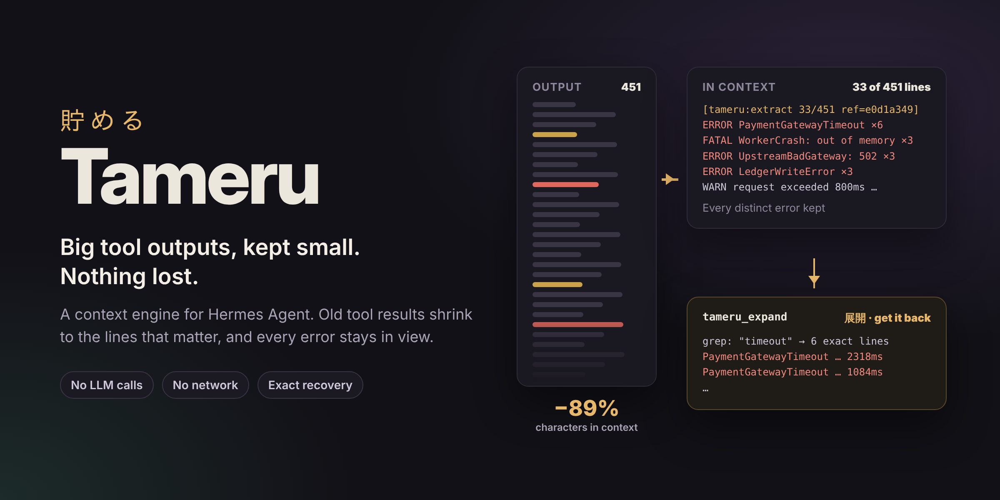
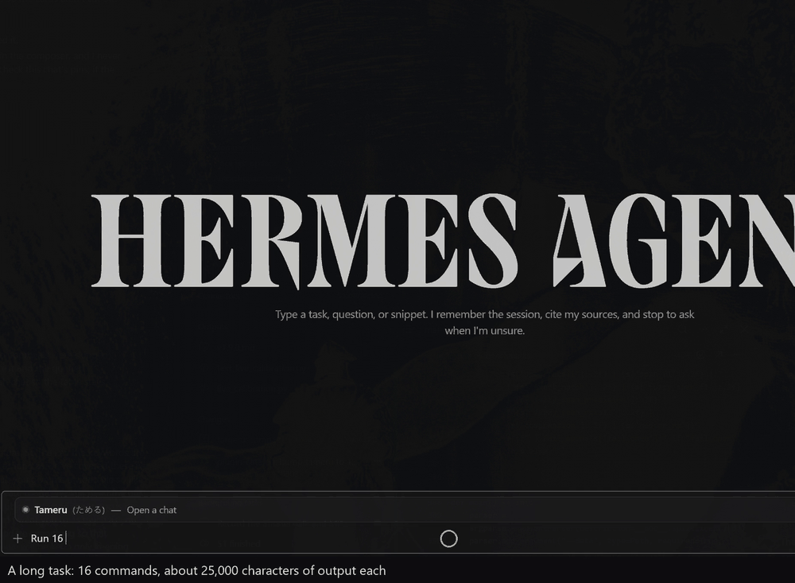
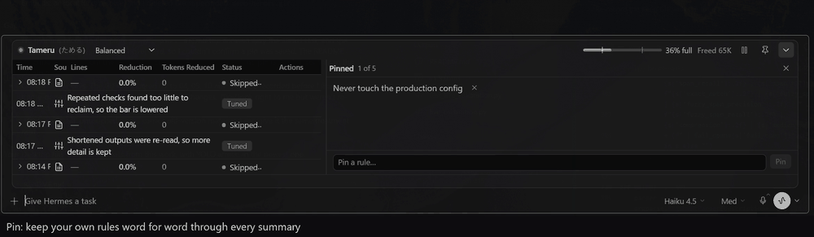
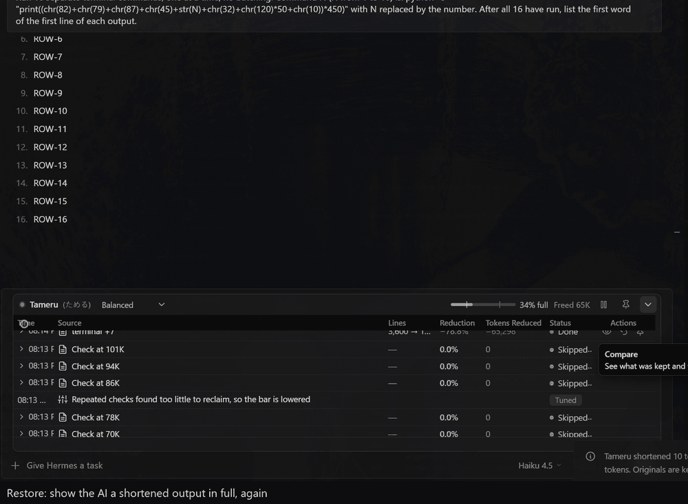
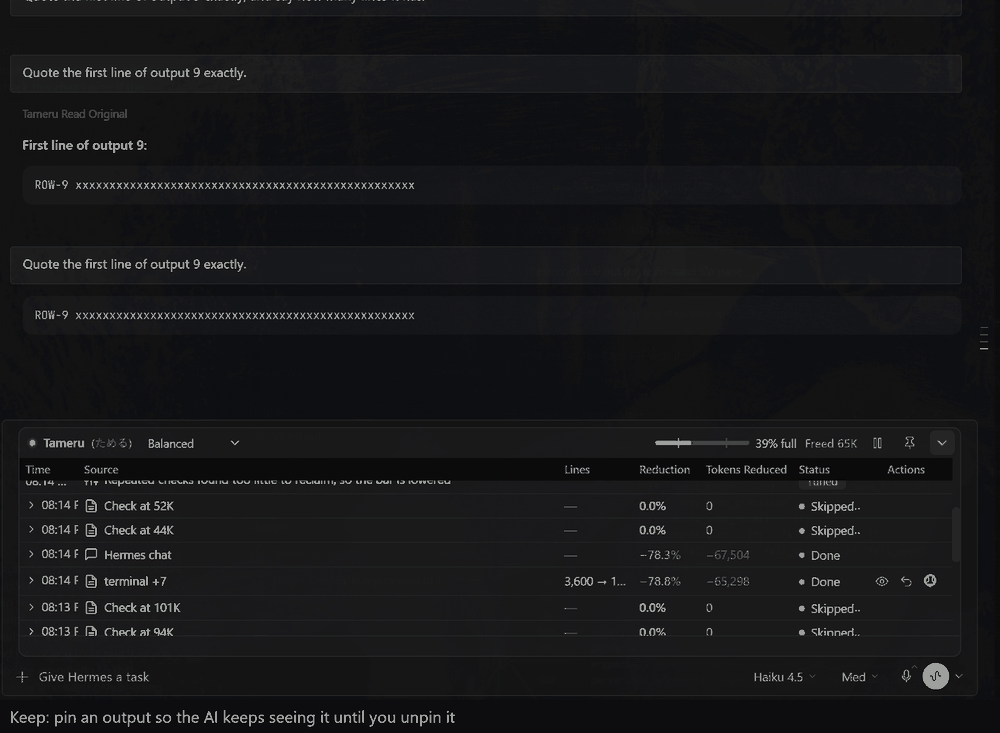

# hermes-tameru-plugin

<p align="center">
  <br><br>
  <a href="CHANGELOG.md"></a>
  <a href="https://github.com/NousResearch/hermes-agent"></a>
  <a href="https://github.com/0xWhiteMage/tameru-compaction-system"></a>
  <a href="LICENSE"></a>
  <a href="https://x.com/0xWhiteMage"></a>
  <a href="https://ko-fi.com/0xwhitemage"></a>
</p>

**Adaptive context compaction for [Hermes Agent](https://github.com/NousResearch/hermes-agent). The instructions you pin survive every compaction.**

Long Hermes sessions fill up with bulky tool output, and every summary risks losing a rule you gave early on. This plugin — a context-engine plugin, no Hermes source changes — uses the [Tameru engine](https://github.com/0xWhiteMage/tameru-compaction-system) (vendored, 1.10.0) to fix both.

- **Pin the lines that must never be lost** — `/tameru pin TEXT` carries your line word for word into every Hermes summary of the chat
- **Shorten the bulk, keep the evidence** — adaptive compaction trims old tool output as context fills, keeps every distinct error, and the original is one call away
- **Stay in control** — **Keep** or **Restore** any output in full, read what was removed in the **Left Out** viewer, and `enabled: false` gives you stock Hermes back



*A real run in Hermes Desktop: sixteen commands of ~25K characters each; ten outputs shortened, ~65K tokens freed, answers correct.*

[Install](#install) · [Features](#features) · [How it works](#how-it-works) · [Settings](#settings) · [Docs](#documentation)

## Install

Requires **Hermes 0.23.x** (tested on 0.23.1) and Python 3.11+.

From the Hermes plugin catalogue:

```bash
hermes plugins install tameru     # later: hermes plugins update tameru
```

The catalogue entry lists Linux only (`platforms: [linux]` in Hermes' `plugin-catalog/tameru.yaml`), so on Windows and macOS
Hermes refuses this command ("unavailable on win32"/"darwin"). There, use one of the two routes below.

Or directly from this repository, as a user plugin directory:

```bash
git clone https://github.com/0xWhiteMage/hermes-tameru-plugin
cp -r hermes-tameru-plugin/hermes_tameru_plugin ~/.hermes/plugins/tameru
```

Or with pip (Hermes loads pip-installed plugins once enabled):

```bash
pip install git+https://github.com/0xWhiteMage/hermes-tameru-plugin
hermes plugins enable tameru
```

Then select the engine in `~/.hermes/config.yaml` and restart Hermes:

```yaml
context:
  engine: tameru
```

## Features

| What | How |
|---|---|
| **Pins** | `/tameru pin TEXT` or the panel — up to 5 lines kept verbatim in every summary; credential-shaped text is refused (heuristic) |
| **Keep / Restore** | Keep shows the model the full original until released; Restore shows it for the next few replies. Saved history is never edited |
| **Desktop panel** | A gauge, a table of every cleanup, and the Left Out viewer showing exactly what was dropped |
| **Adaptive compaction** | The prune trigger follows the model's window and tunes itself from live signals, within bounds — on by default |
| **Artifact Trail** | Every summary names files touched, commands and their last exit code, and one line per distinct error |
| **Commands** | `/tameru help`, `stats`, `reset`, `view N`, `keep N`, `restore N`, `pin`, `purge` |

The engine runs locally — no LLM call, no GPU. It fails open: if it is slow, crashes or misbehaves, nothing in your chat changes.

**Why the Hermes plugin restarted at 0.1.0.** The Hermes integration now has its own release numbering, independent of the Tameru Engine. `1.11.0` was the last release on the previous numbering scheme. `0.1.0` starts the plugin’s independent version line. The engine is still bundled and retains its own version, which you can see alongside the plugin version in `/tameru stats`. See the [changelog](CHANGELOG.md) for release history.

**What 0.1.0 carries forward.** From the final engine-aligned release: `policy_mode: plan` (opt-in, replay-only evidence), hard wall-clock bounds around engine calls, the shared Tameru bar, engine 1.10.0 and per-chat records in Hermes' public plugin state. The `v0.1.0` tag vendors the engine release commit `d37fd43`; `main` currently vendors later 1.10.0-line fixes at `6ea331c` (see [Unreleased](CHANGELOG.md#unreleased)).

## How it works

1. **Hermes decides when** — it still decides when to prune, which rows, and whether a pass commits; the plugin decides what a shortened row keeps
2. **The engine extracts** — a query-aware extract against your task, keeping every distinct error; ambiguous or thin savings return the original
3. **You can always get it back** — Keep, Restore, `tameru_read_original`, and the Left Out viewer; originals live in the session log
4. **It verifies itself** — `get_status()["tameru"]` reports which Hermes seams were found; a pass with no engine, a bad extract or a wall-clock timeout changes nothing

## Settings

Read in order: `TAMERU_HERMES_<FIELD>` env vars, `ctx.get_config`, then `plugins.entries.tameru.settings` in the Hermes config. Restart after a change.

```yaml
plugins:
  entries:
    tameru:
      settings:
        max_extract_chars: 4000
        exempt_tools: [my_custom_tool]
        policy_mode: adaptive   # or: plan
```

| Setting | Default | Meaning |
|---|---|---|
| `enabled` | `true` | Kill switch: `false` is Hermes' built-in compressor, byte for byte |
| `policy_mode` | `adaptive` | `adaptive` (incumbent) or `plan` (engine-planned rewrites, opt-in) |
| `price_profile` | `anthropic-sonnet-5.5-5m` | Prices `plan`'s EV check |
| `min_tool_chars` | `400` | Results shorter than this take Hermes' one-line path |
| `max_extract_chars` | `6000` | Cap on a rendered extract row |
| `min_savings` | `0.10` | An extract must be at most `(1 - min_savings)` of the original |
| `max_risk` | `high` | Highest `compression_risk` an extract may carry |

Measured behaviour and the full knob list: [CHANGELOG.md](CHANGELOG.md) · [docs/DEVELOPMENT.md](docs/DEVELOPMENT.md)

## See it work

**Pin.** Type a rule or use the panel's pin list — it survives every summary, verbatim.



**Restore.** The undo arrow puts the full original in front of the model on your next message.



**Keep.** The lock holds the full output until you release it.



## Documentation

| I want to… | Go to |
|---|---|
| Every setting and its default | [the settings table](#settings) |
| Version history + replay numbers | [CHANGELOG.md](CHANGELOG.md) |
| What the shared plugin bar looks like | [engine PLUGIN-UI spec](https://github.com/0xWhiteMage/tameru-compaction-system/blob/v1.10.0/docs/PLUGIN-UI.md) |
| The engine itself | [tameru-compaction-system](https://github.com/0xWhiteMage/tameru-compaction-system) |
| The DeepSeek Harness sibling | [dsh-tameru-plugin](https://github.com/0xWhiteMage/dsh-tameru-plugin) |

## Credits

Built by thewhitemage for [Hermes Agent](https://github.com/NousResearch/hermes-agent). *Tameru* (ためる) means "to store up".

[Follow on X](https://x.com/0xWhiteMage) · [Ko-fi](https://ko-fi.com/0xwhitemage) · [Issues](https://github.com/0xWhiteMage/hermes-tameru-plugin/issues) · [Apache-2.0](LICENSE)
