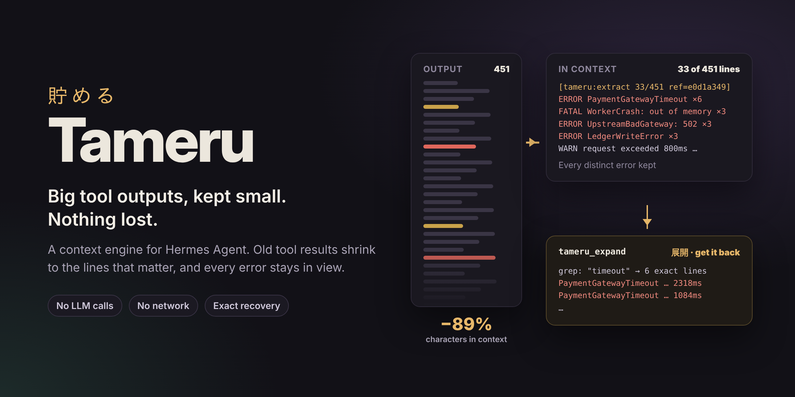

# hermes-tameru-plugin



[Tameru](https://github.com/0xWhiteMage/tameru-compaction-system) deterministic, extractive context compaction for
[Hermes Agent](https://github.com/NousResearch/hermes-agent), as a standalone context-engine plugin (no Hermes source
changes). **Version 1.9.0**, vendoring Tameru 1.9.0 (1.7.0 was a release candidate that was never published; see the
[changelog](CHANGELOG.md)).

When Hermes trims an old tool result, Tameru keeps a query-aware extract or a structural brief, with diagnostic
retention checks. Use /tameru to inspect what changed and view an original when it remains in the bounded recovery
store or the session archive. Viewing an original does not by itself restore it to the model's context; **Restore** and **Keep** (Desktop, or
`/tameru restore|keep REF`) show the full original on the next requests and never edit saved history. Hermes still
decides when to prune, which rows, and whether a pass commits.

Measurements: [docs/COST-TUNING-2026-11-10.md](docs/COST-TUNING-2026-11-10.md) (the current replay results, what was tried and
rejected, and the live checks); the older [docs/REPORT-1.7.0.md](docs/REPORT-1.7.0.md). Validation of the 1.8.0 additions, with what was and
was not run: [docs/RELEASE-1.8.0.md](docs/RELEASE-1.8.0.md). Changes by version: [CHANGELOG.md](CHANGELOG.md).
Releasing: [docs/RELEASING.md](docs/RELEASING.md). When something looks wrong: [docs/RUNBOOKS.md](docs/RUNBOOKS.md).

## Two repositories

Tameru (ためる) is split on purpose. The **engine**
([`tameru-compaction-system`](https://github.com/0xWhiteMage/tameru-compaction-system)) is harness-agnostic: it runs on
any agent harness through its Python API, CLI or transcript adapter. **This repository is the Hermes plugin**: it
vendors the engine unchanged and owns everything Hermes-specific, namely the adaptive policy and self-tuning, Restore
and Keep, the per-turn note, the Desktop panel, the `/tameru` commands and the chat-surface security gates. Who owns
what, where a change belongs, and how releases flow between them: [docs/REPOSITORIES.md](docs/REPOSITORIES.md).

## At a glance

Everything below comes from a **replay**: scripted agent sessions run against real Hermes imports with a simulated clock, prefix-cache
pricing and a deliberately lossy fake summarizer. It does not measure live-agent task success or real provider bills (the live evidence is a
handful of manual checks with Claude Haiku on Hermes Desktop, listed in [docs/COST-TUNING-2026-11-10.md](docs/COST-TUNING-2026-11-10.md)).
Hermes commit `2bd378ed` (v0.23), 11 session shapes, five context windows from 32K to 200K, six seeds.

**Cost against Hermes as shipped** (mean over the 11 shapes; negative is cheaper). The second row also prices what an arm loses: a fact it
dropped costs a re-run of the tool, a fact it only holds behind a `tameru_read_original` call costs that call.

| | 32K | 48K | 64K | 128K | 200K |
|---|---:|---:|---:|---:|---:|
| Input cost | -7.4% | -2.7% | -0.8% | -5.7% | -4.0% |
| Input cost, with lost and recoverable facts priced | -8.4% | -5.0% | -2.4% | -7.3% | -4.3% |

Needed facts across all cells: Hermes keeps 1,345 and loses 355 (91 cannot be re-run); Tameru keeps 1,511, can read back 48 more, and loses 141 (30).

**When Tameru costs more.** Be aware of these before turning it on:

- **A session that never reaches a compaction costs 3% to 5% more** (+3.2% to +5.1% in the five such shapes, at every window). The cause is the
  one tool, `tameru_read_original`, listed on every request. `expand_tool: false` removes it, and with it the ability to read an original back.
- **Many small results cost more on small windows.** With results of 800 to 3,000 characters the plugin costs +10.5% at 32K, +4.0% at 48K and +1.4% at 64K
  (it still loses fewer needed facts than Hermes). There is no loss at 128K and above beyond the tool above.
- **Per-turn note and self-tuning are not free.** With the note running, the replay costs 0.2% to 1.0% more on average and up to 6.8% in one cell; self-tuning
  has not been shown to help (switching it off is slightly cheaper at 32K to 64K).
- At a 200K window the plugin prunes before Hermes would compact and keeps two or three fewer facts than Hermes in three shapes; the tool reads them back.

[Protocol and raw results](docs/COST-TUNING-2026-11-10.md); the older 1.7.0 replay is kept in [docs/REPORT-1.7.0.md](docs/REPORT-1.7.0.md).

## What it does

The plugin is a Hermes context engine (`context.engine: tameru`). It subclasses Hermes' `ContextCompressor` and
hooks the step where Hermes demotes a single tool result. Hermes' own gates all still apply: proactive-prune
thresholds, tail protection, the minimum-reclaim and re-arm gates, the `archive_and_compact` commit and tool-call
pairing repair. Where Hermes would write a one-line summary, the plugin runs a deterministic ladder:

1. **Supersession.** A read made stale by a later write or patch of the same path, a re-read of the same path and
   range, a repeated identical call, or an older state snapshot (`git status`, `ls`, a todo view, ...) becomes a
   header-only row noting which message superseded it.
2. **Extract.** A query-aware extractive cut (the engine's `compress_context`). The query is the task: the user's
   words plus the calls around the result, minus any part naming a file or identifier absent from the output. The
   extract is accepted only if it is not fail-open, its risk is within `max_risk`, it saves at least `min_savings`,
   fits `max_extract_chars`, and **keeps at least one line of every distinct ERROR/FAIL template** of the original.
   An extract over the cap is retried at fixed budgets; a forced cut must still keep a line the query points at.
3. **Brief.** Otherwise a structural brief: error exemplars, query lines, warnings, head and tail (JSON-aware for
   JSON). It starts at `brief_chars` and grows, up to the extract cap, until it holds every error template.
4. **Errors / header.** In the pressure pass, or for old rows once the retained budget is spent: the header plus one
   line per error template (the `errors` rung, with its own budget), or a header-only row when the result had no
   errors.
5. **Hermes' own line** as the last resort.

### When it prunes

Hermes ships its proactive tool-result prune off. Unless you set `compression.proactive_prune_tokens` yourself,
the plugin turns it on with a trigger that follows the model's window, re-derived whenever the model changes:

| Window | Hermes' compaction threshold | Plugin's prune trigger |
|---|---|---|
| 32K | 27,200 | 16,320 (0.60 of the threshold) |
| 48K | 40,800 | 24,480 |
| 64K | 54,400 | 48,000 (the floor) |
| 128K | 96,000 | 72,000 (0.75 of the threshold) |
| 200K | 150,000 | 112,500 |
| 256K | 192,000 | 144,000 |

After a prune, the next one may fire once the prompt has regrown by 20% of the threshold, and a repeat prune on a
large window only goes ahead if it brings the prompt down to 30% of the threshold or less, so it is worth the
prompt-cache break. The proactive prune keeps Hermes' own minimum result size of 8,000 characters; a full compaction prunes results from 1,000 characters, so the
summarizer reads stubs instead of raw rows.

### Properties

- **No LLM calls are added.** The ladder is pure Python and byte-deterministic. Hermes' summarizer runs when Hermes
  decides to run it.
- **Committed rows do not change between commits.** A rendered row is left alone unless Hermes is committing a pass
  that demotes it further, so the plugin never breaks the prompt-cache prefix on its own. Hermes' no-op contract
  (`prune_tool_results_only` returns the input object when nothing changed) holds, and `compress()` passes
  `bypass_cooldown` and every other keyword through.
- **Every rendered row names its original.** Its first line is Hermes' own one-line summary followed by
  `[tameru:<rung> kept K/N lines (KC of TC chars) ... ref=<16 hex>]`. Hermes' envelope fields (`exit_code`,
  `error`, `total_lines`) stay on a compact meta line, so Hermes' own regexes still match; gaps use Hermes' elision
  marker.
- **Read original: `tameru_read_original(ref, start_line, end_line, grep, max_chars)`** (the old name `tameru_expand` is still answered but not listed, so the schema is sent once). Returns the exact original lines (a
  range, or the lines matching a regex) as JSON, capped at `max_chars` (default 12,000; at most 50,000) with a
  continuation hint. Originals come from a per-agent in-memory store and, when Hermes' session database is
  reachable, from the compaction archive, so a ref can also resolve after a restart, `--resume` or a session rotation.
  Originals that look like they hold a credential are never stored. A miss points the model to `session_search`.
  Refs are hashes of the call ids and the original; they are not secret.
- **Artifact trail** (`ledger`, on by default). Hermes' compaction summary gains an exact
  `## Artifact Trail (Tameru, from tool calls)` section: files touched and how, commands with their last exit code, and one
  line per distinct error template of the summarized results. It goes through Hermes' compaction redactor like
  every other section Hermes appends. The summarizer itself sees Tameru rows as Hermes' own one-liners, without refs.
- **Untrusted content stays marked.** Web, browser and MCP results keep Hermes' `<untrusted_tool_result>` wrapper
  in every rendered row and every `tameru_read_original` answer, and their lines never enter the artifact trail.
- **Small windows keep less.** The retained extract and error budgets scale with the window below a 64K window and
  with the compaction threshold above it.
- **Lean tail.** In Hermes' `tail_mode: lean`, tail rows Hermes stubs get a Tameru header-only row that keeps the
  ref. Hermes' `<persisted-output>` spill rows keep their "Full output saved to" path.
- **Exempt** (Hermes' handling applies): `skill_view`, `skills_list`, `skill_manage`, `clarify`, `todo`,
  `todo_list`, `memory`, `session_search`, `tameru_read_original`, `delegate_task`, `cronjob_manage`, `process_manage`,
  refused or blocked results, anything in `exempt_tools`, and results shorter than `min_tool_chars`.

Historical v1.6.0 per-result measurements (not rerun for 1.7.0): per result, on 13 agent outputs (logs up to 650 KB, `cat -n` source, diffs, `rg`, pytest, JSON, YAML, CJK) the plugin
saves 86.6% of characters and keeps 14/14 answer strings and 22/22 error templates (`tests/eval/per_result.py`).

## Requirements

- Python 3.11 to 3.14.
- Hermes Agent with the context-engine plugin API (see [Compatibility](#compatibility)).
- No runtime dependencies (standard library only; `pyyaml` is a fallback config reader if Hermes' loader is
  unavailable).

## Install

From the Hermes plugin catalogue:

```bash
hermes plugins install tameru     # later: hermes plugins update tameru
```

Or directly from this repository, as a user plugin directory:

```bash
git clone https://github.com/0xWhiteMage/hermes-tameru-plugin
cp -r hermes-tameru-plugin/hermes_tameru_plugin ~/.hermes/plugins/tameru
```

or with pip (entry-point discovery; Hermes loads pip-installed plugins only once they are enabled):

```bash
pip install git+https://github.com/0xWhiteMage/hermes-tameru-plugin
hermes plugins enable tameru
```

Then select the engine in `~/.hermes/config.yaml` and restart Hermes:

```yaml
context:
  engine: tameru
```

`get_status()["tameru"]` confirms that the Hermes seams were found (see [Status](#status-and-isolation)).

**Showing "Tameru (ためる)" in Desktop's Settings.** Desktop's Settings > Context Engine labels each engine from the
saved `context.engine` value, and Hermes finds the engine by a plugin folder of exactly that name, so the label only
changes if the folder and the value change together. `scripts/use_display_name.ps1` does exactly that (plan first,
`-Apply` to do it, `-Revert` to undo):

```powershell
pwsh scripts/use_display_name.ps1 -Apply     # plugins\tameru -> plugins\tameru_(ためる), context.engine to match
```

The plugin's own id stays `tameru` (it comes from `plugin.yaml`), so `plugins.enabled`, `plugins.entries.tameru` and the
Desktop panel are untouched, the old folder is kept in `plugin-backups/` (never inside `plugins/` or `desktop-plugins/`: Hermes and Desktop load every folder
there, hidden or not, and two copies clash on the id), and `config.yaml` is copied first.
Restart the gateway and reload Desktop afterwards. Without it everything works as before under the plain name `tameru`,
which is also what `hermes plugins install tameru` creates.

## Configuration

Every setting is read, highest priority first, from `TAMERU_HERMES_<FIELD>` (the field name upper-cased,
e.g. `TAMERU_HERMES_MAX_EXTRACT_CHARS`), `ctx.get_config(<field>)` when the host offers it, then
`plugins.entries.tameru.settings` in the Hermes config (`plugins.entries.tameru.config` is read as a fallback).
The legacy process-environment overrides apply only to the process's launch profile. Other profiles served by
that process use their own YAML settings. The Python API can still accept an explicit `env` mapping.
Booleans accept `1/0/true/false/yes/no/on/off`; lists take a YAML list or, in an environment variable, a
comma-separated string. A value that does not parse is ignored with a warning (listed in
`get_status()["tameru"]["warnings"]`). Settings are read when the engine is created: restart Hermes after a change.

```yaml
plugins:
  entries:
    tameru:
      settings:
        max_extract_chars: 4000
        exempt_tools: [my_custom_tool]
```

**Ladder**

| Setting | Default | Meaning |
|---|---|---|
| `enabled` | `true` | Kill switch: `false` is Hermes' built-in compressor, byte for byte. |
| `min_tool_chars` | `400` | Results shorter than this take Hermes' one-line path. |
| `max_extract_chars` | `6000` | Cap on a rendered extract row, header and markers included. |
| `brief_chars` | `1200` | Starting size of a brief (it grows up to `max_extract_chars` while an error template is missing). |
| `brief_share` | `0.0` | Start the brief at this share of the result instead, when larger (0 to <1). |
| `max_risk` | `high` | Highest engine `compression_risk` an extract may have (`low`, `medium`, `high`). The engine rates almost any cut past ~80% "high"; a lower ceiling mostly pushes rows to the brief. |
| `min_savings` | `0.10` | An extract must be at most `(1 - min_savings)` of the original. |
| `exempt_tools` | `[]` | Extra tool names left to Hermes (added to the built-in exempt set). |
| `protect_patterns` | `[]` | Regexes; matching lines are pinned in extracts. |
| `anchor_errors` | `true` | With no usable query, or a generic query that matches little or nearly everything, compress a result around its errors; small erroring logs keep every error fingerprint and nearby context (compiler/test/runtime diagnostics in many languages). |
| `prose_brief` | `true` | With no usable query on prose or docs (any language; sentences are split for Latin scripts, CJK, Thai, Devanagari and Arabic), keep a structure-preserving extractive brief; the original stays expandable. |
| `supersession` | `true` | Structural supersession. |
| `pass_char_budget` | `4000000` | Original characters the ladder may process in one pass; rows beyond it use Hermes' line. |

**Retained budgets**

| Setting | Default | Meaning |
|---|---|---|
| `retained_extract_budget_chars` | `6000` | Total extract/brief body size rendered rows may keep, newest first; rows beyond it step down to a header (ref kept), only inside a pass Hermes commits. |
| `retained_extract_budget_ratio` | `0.10` | The budget is `max(retained_extract_budget_chars, ratio x compaction threshold)`: 6,000 up to 64K windows, 9,600 at 128K, 15,000 at 200K. `0` keeps the fixed value. |
| `retained_error_budget_chars` | `8000` | Total size of `errors` rows kept, newest first. |
| `errors_row_chars` | `1600` | Cap on the error lines of one `errors` row; `0` turns the rung off. |
| `small_window_threshold_tokens` | `54400` | Below this compaction threshold (a 64K window) both budgets shrink in proportion: 3,000 and 4,000 chars at 32K. `0` keeps the fixed sizes. |

**Pruning** (each `default_*` applies only when you have not set the matching `compression.*` key)

| Setting | Default | Meaning |
|---|---|---|
| `default_proactive_prune_tokens` | `48000` | Floor of the plugin's prune trigger. |
| `default_proactive_prune_ratio` | `0.75` | Trigger = `max(floor, ratio x compaction threshold)`. `0` keeps the floor. |
| `small_window_prune_ratio` | `0.60` | Where that trigger would not be below the threshold (windows under ~57K) it is `ratio x threshold` instead. `0` keeps the floor. |
| `prune_regrowth_ratio` | `0.20` | After a prune, the next may fire once the prompt regrows by `ratio x threshold` (Hermes' own rule waits for a full trigger-sized regrowth). Applies to the plugin's window-derived trigger only. `0` keeps Hermes' rule. |
| `reprune_target_ratio` | `0.30` | On windows where `default_proactive_prune_ratio` sets the trigger, a repeat prune is declined unless it leaves the prompt at or below `ratio x threshold`. `0` turns the gate off. |
| `default_proactive_prune_min_result_chars` | `8000` | Smallest result the prune touches (Hermes' own default). |
| `prune_tail` | `tokens` | Tail the prune protects: `tokens` (the shorter of `protect_last_n` and the compaction's tail token budget; the pressure pass also runs) or `count` (Hermes' `protect_last_n`). |

**Recovery and telemetry**

| Setting | Default | Meaning |
|---|---|---|
| `expand_tool` | `true` | Add `tameru_read_original` to the tool list (the old name `tameru_expand` is still answered, but no longer listed). |
| `expand_grep_timeout` | `2.0` | Seconds a grep with a repeat or alternation may run. It runs in a stdlib-only child process (`python -I -S`) that is killed after this; plain patterns run in-process. |
| `expand_grep_line_chars` | `20000` | Characters of each line a grep searches (longer lines: their head only, reported as `lines_capped`). |
| `store_max_entries` | `512` | Originals kept in memory per agent (LRU). |
| `store_max_chars` | `32000000` | Combined character budget for original text, tool names and compact envelope metadata (LRU). |
| `ledger` | `true` | Add the artifact trail to Hermes' compaction summary. |
| `telemetry_log` | `""` | Path of a JSONL file for render events; empty means off. |

### `compression.*` is mirrored

Hermes hands a plugin engine none of the user's `compression:` section, so the plugin passes it to the compressor
itself, with the same mapping as Hermes' `_parse_compression_config`:

| `compression.` key | `ContextCompressor` argument |
|---|---|
| `threshold` | `threshold_percent` |
| `protect_first_n` / `protect_last_n` | same names |
| `target_ratio` | `summary_target_ratio` |
| `abort_on_summary_failure` | same name |
| `threshold_tokens` | `threshold_tokens_cap` |
| `proactive_prune_tokens` | same name |
| `proactive_prune_min_result_chars` | same name |
| `proactive_prune_min_reclaim_tokens` | same name |
| `min_tail_user_messages` | same name |
| `tail_mode` | same name |
| `model_thresholds` | same name |

A value you set always wins over the plugin's defaults. An argument the running Hermes does not accept is dropped
with a warning; an out-of-range `threshold` is ignored. Hermes' Codex threshold autoraise applies as in Hermes.

## Status and isolation

`engine.get_status()["tameru"]` reports (plain JSON): `version`, `engine_version`, `enabled`; `seams` (which Hermes
hooks were found, with `reasons` for missing ones); `expand_injected`; `store` (`entries`, `chars`); `isolated`;
`telemetry`; `warnings`.

The engine must run in the Hermes process, Hermes' default (`plugins.isolation: in_process`). Under `host`
isolation Hermes hands the plugin a placeholder instead of the session database: the engine detects it
(`isolated: true`) and serves `tameru_read_original` from its own memory only, so refs do not survive a restart.

### Serving many sessions

- Each agent (including subagents, via `clone_for_agent`) has its own store, memo and telemetry; one agent cannot
  read another's originals.
- The recovery store applies `store_max_chars` to original text, tool names and compact metadata, and also has an
  entry-count cap. The extract memo has a separate 4M-character cap. Python object overhead is additional.
- Telemetry holds counts, tool names, rungs and ref hashes only: no message text and no session id.
- Tameru's Python extraction and recovery code adds no external network calls. Its only child process is the
  short-lived grep worker, and its optional file output is `telemetry_log`. Desktop inspection uses Hermes'
  existing connection.

## Telemetry

Counters under `get_status()["tameru"]["telemetry"]`:

- `events`, each with a `count` and a per-label breakdown: `render` (labels `rung`, `tool`, and `demoted` for rows
  aged down), `parent_line` (rows left to Hermes' line), `lean_tail`, `escalation` (Hermes declined a prune the
  plugin rendered, so the pass was retried once with header-only rungs), `budget_skip`, and `error` (label `where`;
  the plugin fell back to Hermes' behaviour for that row);
- `chars`: `before`, `after`, `saved`;
- `time`: seconds and calls inside the engine's public calls.

With `telemetry_log` set, each rendered row also appends one JSON line (`event`, `rung`, `tool`, `ref`,
`chars_before`, `chars_after`). A logging error never affects a prune.

## Kill switch and fallbacks

- `enabled: false` (or `TAMERU_HERMES_ENABLED=0`) defers every override to Hermes: no ladder, no artifact trail, no
  `tameru_read_original`, Hermes' own `compression.*` defaults. The replay is byte-identical to Hermes'.
- At start the engine probes the Hermes hooks it needs. If the demotion seam is missing or has another signature,
  the engine runs as stock Hermes and says why in `get_status()["tameru"]["seams"]["reasons"]`; a missing optional
  seam disables only its feature. An exception inside the ladder falls back to Hermes' line for that row and is
  counted under `error`.
- The engine class is built from `agent.context_compressor` when `engine.py` is first imported. If a pip-installed
  plugin is imported while that Hermes module is still importing (only when a script imports
  `agent.context_compressor`, `agent.agent_init` or `gateway.run` first), the engine is unavailable for that process
  and Hermes uses its built-in compressor.

## Limitations

- The plugin hooks private Hermes methods. A Hermes refactor can disable it (safely, as above) until the plugin is
  updated; CI runs against Hermes `main` nightly to catch that early.
- It is extractive: an extract keeps lines, not meaning. A fact that was only in a cut region is out of context
  until the model calls `tameru_read_original` or re-runs the tool. A row whose original was never stored (evicted,
  credential-like, or a restart without a reachable archive) cannot be expanded.
- A proactive prune cannot know whether a session will ever reach compaction. A session that peaks just past the
  trigger is pruned and can lose a fact Hermes would have kept; the recovery tool can return it only while an original remains available.
- Output whose extract cannot shrink under `max_extract_chars` (big logs, very large `grep` output) ends as a brief:
  every error template stays, but a specific matching line can be cut.
- Historical v1.6.0 measurements: savings per result are lower than the engine alone on the same text (68.6% against 82.3% mean on the engine's
  benchmark corpus, 16/16 gold kept by both): Hermes' elision marker is about 100 characters per gap and each row
  carries a header. Short documents with many gaps suffer most (`travis_yaml` 23.2% against 76.8%).
- `tameru_read_original` is offered only when Hermes injects context-engine tools: with no toolset restriction, or one that
  includes `context_engine` (`hermes chat -t terminal,file,context_engine`). Newer Hermes logs
  `capability_check ... capability=tools.override decision=deny` at plugin load; that is Hermes probing its
  tool-override policy, not an error.

## Compatibility

The 1.7.0 candidate was exercised against real Hermes `a0a49926` on Windows,
with stub checks and a clean Python 3.13 import-isolation check. The
[validation report](docs/REPORT-1.7.0.md#integration-and-packaging-checks)
distinguishes full assembly runs from targeted post-fix coverage. The plugin
validator passed 15 checks with zero warnings at that revision.

1.8.0 was also exercised live in Hermes Desktop on Windows (local backend), with Hermes' own plugin validator
and the real-Hermes seam checks; [docs/RELEASE-1.8.0.md](docs/RELEASE-1.8.0.md) lists exactly what ran and what did
not. The bundled panel also has DOM behavior tests. Hermes changes independently, and the plugin relies on
private compressor seams, so these checks are not a promise of compatibility
with every later Hermes revision. Nightly CI also checks Hermes `main`.

## What Tameru stores

| What | Where | Size | How to remove it |
|---|---|---|---|
| Originals of shortened outputs (never anything that looks like a credential) | the engine's memory (512 entries, 32M characters), and Hermes' own session archive | bounded | ends with the process; Hermes' session delete for the archive |
| Per-chat self-tuning, pause and lean mode | the chat's session metadata, `tameru_tuner_v1` | a few numbers | goes with the chat; a new chat starts clean |
| Per-chat host settings (summary threshold and protected tail, adapted within bounds). Off by default | the chat's session metadata, `tameru_host_v1` | two numbers | leave `adaptive_host` off; goes with the chat. Your `config.yaml` is never written |
| Pinned instructions (your own lines) | the chat's session metadata, `tameru_pins_v1` | up to 5 lines, 1,500 characters | `/tameru unpin N`; goes with the chat |
| Keeps (pinned outputs) | the chat's session metadata, `tameru_edits_v1` | up to 64 short references | `/tameru unkeep REF`; goes with the chat |
| Restores | engine memory only | up to 64, five replies each | `/tameru cancel`, or they expire |
| What self-tuning learned across chats. Off by default | `$HERMES_HOME/tameru/learned.json` | five numbers, moving at most 0.12 a day | delete the file; it is written only with `learned_priors: on` |
| Telemetry log (only if `telemetry_log` is set) | under `$HERMES_HOME` or the temp folder | rotates at 5 MB, keeping one `.1` file | delete the file; it holds counts, tool names, rungs and reference hashes, never text |
| Desktop hint flag | the browser's `localStorage`, one flag | one flag | clear site data |

Tameru makes no network calls. The per-turn note and Restore only change what goes in the request to the model you
already use.

## Uninstall

1. Set `context.engine: compressor` (or remove the `context.engine` line).
2. `hermes plugins disable tameru` (pip installs).
3. Delete `~/.hermes/plugins/tameru/`, or `pip uninstall hermes-tameru-plugin`.

Rewritten rows stay in session history as ordinary text; their `ref=` can then be reached only through the session
archive and `session_search`.

## The vendored engine

`hermes_tameru_plugin/tameru/` is a byte-for-byte copy of `tameru-compaction-system/src/tameru/`, except
`__init__.py`, which this repo owns and which records the source commit as `VENDORED_FROM`. Never edit vendored
files here; change the engine upstream and re-sync:

```bash
# in the engine checkout
python scripts/sync_to_harness.py <this_repo>/hermes_tameru_plugin/tameru --manifest ../plugin.yaml          # apply
python scripts/sync_to_harness.py <this_repo>/hermes_tameru_plugin/tameru --manifest ../plugin.yaml --check  # drift check
```

Then update `VENDORED_FROM`, run both test modes and review the replay baselines
([docs/DEVELOPMENT.md](docs/DEVELOPMENT.md)). The plugin version always equals the vendored engine's version.

## More

- [docs/REPORT-1.7.0.md](docs/REPORT-1.7.0.md): current candidate validation and frozen replay; [1.5.0 report](docs/REPORT-1.5.0.md) for historical measurements.
- [docs/REPOSITORIES.md](docs/REPOSITORIES.md): what the engine repository and this plugin repository each own.
- [docs/RELEASING.md](docs/RELEASING.md): engine, plugin and catalogue release steps. [docs/RELEASE-1.8.0.md](docs/RELEASE-1.8.0.md): the 1.8.0 validation record. [docs/RUNBOOKS.md](docs/RUNBOOKS.md): incidents and rollback.
- [docs/DEVELOPMENT.md](docs/DEVELOPMENT.md): tests, real-Hermes setup, replay harness, CI.
- [docs/compaction-research.md](docs/compaction-research.md): survey of compaction systems and the gap analysis.
- [CHANGELOG.md](CHANGELOG.md), and earlier reports: [1.4.1](docs/REPORT-1.4.1.md), [1.4.0](docs/REPORT-1.4.0.md).

## License

MIT, same as upstream Tameru. See [LICENSE](LICENSE) and [THIRD_PARTY_NOTICES.md](THIRD_PARTY_NOTICES.md).

### Compaction policy mode

**Adaptive is the default**, with or without any Tameru configuration. `legacy` (the fixed prune gates of 1.6) and `fixed` (a comparison aid) stay available:
set `plugins.entries.tameru.settings.policy_mode: legacy`, or switch one chat with `/tameru policy mode=legacy`. Legacy is not cheaper than adaptive
in the replay once lost and recoverable facts are priced, except by 0.7 points at 32K; it is kept as a fallback and is not tuned further.

### Self-tuning and compression progress

In adaptive mode Tameru tunes itself while a chat runs (`autotune`, on by default; `TAMERU_AUTOTUNE=off`
returns to the fixed table). It starts at the old "balanced" numbers and moves them in small, bounded steps
from four signals: Hermes summarizing before Tameru acted, repeated checks that found too little to reclaim,
the model re-reading a shortened output, and context refilling quickly after cleanup. Calm stretches relax it
back. The only user choices are a bias (Save space, Balanced, Preserve detail) and Pause; both persist with the chat.

**Adaptive is the default.** Unless `policy_mode` is set explicitly (`legacy` and `fixed` stay available by choice),
Tameru runs the adaptive, self-tuning policy, including when it is selected with `context.engine: tameru` alone.

**It can learn across chats (off by default: `learned_priors: on`).** Each chat's adjustments then also move a small profile-wide memory
(`$HERMES_HOME/tameru/learned.json`, five numbers, a moving average); calm stretches ease it back toward neutral. A new
chat starts from 60% of what that memory holds, and its own saved state, if it has one, wins. This is online learning
with small, bounded, explainable steps, not a trained model: it adapts to how your sessions behave, and it can be
inspected, reset (delete the file) or switched off (`autotune: off`).

`/tameru` shows compression progress. `/tameru changes` lists shortened outputs, `/tameru show REF` (or `view`) opens an
original, `/tameru ask REF [START-END | term]` gives the exact instruction that makes the agent re-read one, `/tameru bias save|balanced|detail` and `/tameru pause|resume` set the two choices. The older
`/tameru policy key=value` form still works.

- **Desktop:** one condensed panel above the composer, about 30px when closed and a fixed 196px when open (so it never
  jumps). The header reads `Tameru (ためる)` and holds the lean mode (a borderless dropdown), working memory as a thin
  gauge with "N% full" (ticks where Tameru starts and where Hermes compacts), "Freed ~N%" (the share of context removed, not what the chat costs), a pause button and a collapse
  button. It stays silent while everything is fine and only speaks for a state worth knowing (paused, compacting,
  starts with your next message). Every control explains itself in a small hover card, also shown on keyboard focus.
  Below the header, when the panel is wide enough, the list sits on the left and the viewer on the right; when it is
  narrow they swap in one pane. The list shows each Tameru pass, each Hermes summary and each output restored after a
  restart: time, source, lines kept, reduction, exact tokens reduced, status. Click a row's arrow for its method, lean
  mode, input and output tokens, duration and whether the original is available. The eye button opens **Left Out**:
  kept lines show normally and each removed stretch folds into one bar ("117 hidden · 40–156") that expands with a
  highlighted edge. Click line numbers (Shift for a range) or "All" on a bar, then **Add** (small, trusted text) or
  **Re-Read** (large or outside text, or when you would rather the AI fetch it). Both only put text in your message
  box: nothing is sent until you send it, and earlier messages are not edited. Keys inside the viewer: R re-read,
  A select all left-out lines, `[` and `]` turn pages, Enter adds, Esc goes back.
- **Keep and Restore:** on each row, ↺ **Restore** shows the AI the full output for its next few replies and 📌 **Keep**
  does the same until you unpin it. Both wait for your next message, work on what is sent to the model (saved history
  is never edited), and are refused for web content and for anything that held a credential. The Status column reads
  Pending, then Applied or Kept, or Failed with the reason in the hover card. The same verbs exist as
  `/tameru restore|keep|unkeep REF` and `/tameru cancel` on your own clients, and are off in shared chats.
- **Pinned instructions:** `/tameru pin TEXT` keeps a line you wrote (up to 5, 300 characters each, 1,500 together)
  word for word in every Hermes summary of this chat, under `## Pinned by you (Tameru, verbatim)`, so a rule such as
  "never touch production config" cannot be softened by the summarizer. `/tameru pins` lists them and
  `/tameru unpin N` removes one. Nothing is ever pinned for you, text that looks like a credential is refused, the
  verbs work on your own clients only, and `pins: off` / `TAMERU_PINS=off` switches it off. In Desktop the 📌 button in the panel header opens the same list. Saved per chat as
  `tameru_pins_v1`.
- **What the model is told:** each turn, only when something changed, Tameru adds a short `<tameru_note>` to your message
  for the model: how many tool results are shortened and which files it wrote or patched (base names only). It says
  it is data, not instructions, never repeats itself, is capped per session and can be switched off with
  `manifest: off`.
- **CLI, TUI and messaging:** Hermes lets plugins show text only. Hermes's compaction status line gains a short
  "Tameru is ..." clause, and a chat line follows each Tameru commit. Run `/tameru` for the full view.
- After a restart the table is rebuilt from rows Tameru already shortened, only where an archived original proves
  the row for that exact message.

Validated live on Windows: in Hermes Desktop (card, analysis panel, lean mode, a self-adjustment, a real commit,
View original, and the table rebuilt after a gateway restart) and in the classic CLI and the Ink TUI (`/tameru` and
`/tameru changes`, including after a restart). No model turn ran in the CLI or TUI (the provider was rate-limited), so
the compaction status line and the post-commit chat line were checked on Hermes's real compressor and in unit tests only.

### Getting back what was left out

Hermes does not let a plugin rewrite saved history, so recovery adds information instead of editing the past. The
agent is also told, in a short note frozen into each new session, that lines which are not shown are not absent from
the original, and to call `tameru_read_original` with a grep or line range before relying on a detail. Originals that
looked like they held credentials are never stored, so a miss there is expected. To keep an output in front of the model, use **Keep** (Desktop,
or `/tameru keep REF`); to keep a line of your own through every summary, use `/tameru pin`.
